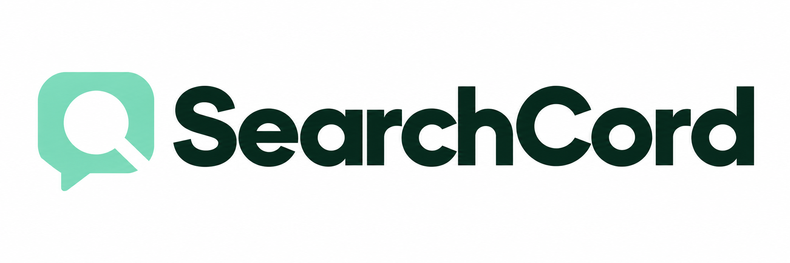

  <picture>
    <source media="(prefers-color-scheme: dark)" srcset="static/brand/searchcord-logo-dark.png">
    
  </picture>

Archive Discord messages. Search them locally. Share a separate, read-only viewer.

  <a href="#get-started">Get started</a> ·
  <a href="#search-only">Search only</a> ·
  <a href="#your-data">Your data</a> ·
  <a href="#release-timeline">Release timeline</a>

## Get started

1. Download the package for your system from [GitHub Releases](https://github.com/k0shir0/searchcord/releases/latest).
2. On Windows, extract the ZIP to a folder and open **Start Searchcord**. Your browser opens when the archive is ready.
3. To update, close both Searchcord apps and open **Update Searchcord** in the same folder. Your archive, media and saved accounts stay in place.

If you already use Searchcord on Windows, close it and extract the first release
into your existing Searchcord folder. Open **Start Searchcord** from there.

See the [operating guide](deploy/native/README.txt) for Linux, macOS, and
existing archives in a custom location. [Build from source](deploy/native/BUILD.md)
if you prefer.

## Use Searchcord

Collection requires a Discord token. Read the [use warning in the license](LICENSE)
before collecting data.

1. Open **Settings**, name your Discord token and select **save & use token**.
2. In **Scrape**, select **connect Discord**, queue channels or direct messages and select **start scraping**. Leave the message limit blank to collect full history.
3. In **Browse**, search messages or filter by server, channel, author or date. Click an author to see their saved profile.
4. In **Stats**, explore activity and open the matching messages.

You can pause a scrape and resume from the last saved page. After restarting
Searchcord, select the original saved account to resume a paused job.

## Search only

On Windows, open **Start Searchcord Search** and visit <http://127.0.0.1:8001>.
You can search an existing archive without connecting a Discord account.

See the [viewer guide](deploy/search/RUNNING.txt) for custom archives and hosting.

## Your data

The default archive is in the **data** folder. Saved tokens are encrypted and
stored separately. Keep archives private and share only data you are entitled
to share.

## Release timeline

Major milestones by the date they reached `main` (America/Chicago).

| Date | Update |
| --- | --- |
| 2026-11-07 | Added prebuilt downloads for Windows, Linux and macOS, with in-place updates on Windows x64. [v0.2.0](https://github.com/k0shir0/searchcord/releases/tag/v0.2.0) |
| 2026-11-05 | The collector, search viewer and archive tools moved to Rust. Existing archives and the browser interface carry forward. Live monitoring now recovers paused after a restart. [#27](https://github.com/k0shir0/searchcord/pull/27) |
| 2026-11-05 | Added compact image storage, geometric avatars and tools to shrink an existing media cache. [#8](https://github.com/k0shir0/searchcord/pull/8) |
| 2026-10-11 | Collection queues stay tied to the selected account when switching tokens. [#4](https://github.com/k0shir0/searchcord/pull/4) |
| 2026-10-10 | Scrape progress reflects messages saved to the archive, and stopping preserves the saved progress. [#5](https://github.com/k0shir0/searchcord/pull/5) |
| 2026-10-09 | Added invite queues, automatic channel and thread discovery, and pause and resume across reloads or restarts. The archive keeps observed edits and deletions, caches media locally and protects saved tokens in an encrypted vault. [Collection](https://github.com/k0shir0/searchcord/commit/9b497d1) [Archive](https://github.com/k0shir0/searchcord/commit/1c9363c) |
| 2026-10-07 | Added portable Windows launchers and a way to remove all saved tokens. [#2](https://github.com/k0shir0/searchcord/pull/2) |
| 2026-10-02 | Search pages load faster on large archives. The read-only viewer can run as a standalone Docker service. [#1](https://github.com/k0shir0/searchcord/pull/1) |
| 2026-09-30 | Added compact search snapshots that can be shared without saved credentials. [Commit](https://github.com/k0shir0/searchcord/commit/e5a7935) |
| 2026-09-28 | Added a separate read-only viewer, saved profile cards and collection of missing profile details. [Viewer](https://github.com/k0shir0/searchcord/commit/844f0cb) [Profiles](https://github.com/k0shir0/searchcord/commit/cf4dea7) |
| 2026-09-26 | Added multiple saved Discord accounts, archive cleanup with confirmation, and server and contributor rankings. [Accounts](https://github.com/k0shir0/searchcord/commit/c32e670) [Rankings](https://github.com/k0shir0/searchcord/commit/4db997b) |
| 2026-09-25 | Reduced archive disk usage and added compressed recovery backups. [Commit](https://github.com/k0shir0/searchcord/commit/bb9f4bd) |
| 2026-09-24 | Brought collection tools into one workspace and expanded interactive activity charts. [Commit](https://github.com/k0shir0/searchcord/commit/2695a19) |
| 2026-09-23 | Introduced the current search layout and filters, resumable scraping and DM message cleanup. [Commit](https://github.com/k0shir0/searchcord/commit/7e89725) |
| 2026-07-23 | Replaced the original scripts with a web app for search, collection, live monitoring and ChatML export. [Commit](https://github.com/k0shir0/searchcord/commit/80df94c) |
| 2025-09-20 | First Discord scraper and archive search scripts. [Scraper](https://github.com/k0shir0/searchcord/commit/2c4f19a) [Search](https://github.com/k0shir0/searchcord/commit/4aab66b) |

## License

[MIT, with a wrongful use warning](LICENSE).
